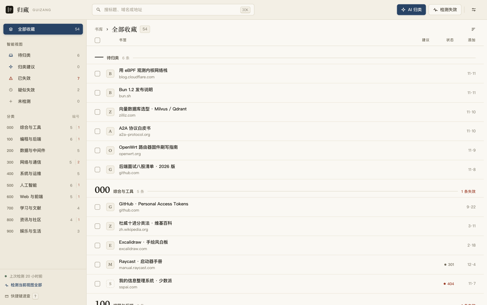

# 归藏 · GuiZang

一个 Chrome 收藏夹管理器：**看得清**（三栏书库）、**归得位**（AI 归类，逐条确认）、**坏得掉**（失效链接体检）。



## 为什么是扩展，而不是一个网页

两件事网页做不到：

1. **读书签树**：`chrome.bookmarks` 只对扩展开放。
2. **跨域拿状态码**：在扩展后台带 `host_permissions` 发请求，才能读到别人站点的 HTTP 状态。网页里的 `fetch` 会被 CORS 挡在门外，只能拿到一个「失败」，分不清 404 还是需要登录。

## 安装

```bash
# 不需要构建，没有依赖
chrome://extensions → 打开「开发者模式」→「加载已解压的扩展程序」→ 选这个目录
```

> **改完代码记得重新加载扩展。** 在扩展页刷新只更新页面，service worker 还是旧脚本，
> 两边消息表对不上，操作就会静默失败。归藏启动时会和后台握一次手，版本对不上会在顶部
> 挂一条提示，点「打开扩展页重新加载」即可。

装好后有三个入口：

| 入口 | 怎么打开 | 干什么 |
|---|---|---|
| 弹窗 | 点工具栏图标 | 把当前页收进某个分类（会先给一个建议） |
| 侧边栏 | 右键图标 → 在侧边栏中打开 | 边浏览边整理，看最近收藏与失效提醒 |
| 书库 | 弹窗底部「打开书库」，或右键图标 → 选项页旁边 | 全屏三栏：书架 / 列表 / 检查器 |

## 分类体系：它读你的文件夹，不强迫你换

标题形如 `000 综合与工具` 的文件夹，会被识别成一个类目，前三位数字即编号：

```
000 综合与工具   100 编程与后端   200 数据与中间件   300 网络与通信   400 系统与运维
500 人工智能     600 Web 与前端   700 学习与文献     800 资讯与社区   900 娱乐与生活
```

没有数字前缀也没关系——会退化成「书签栏下一级文件夹」，用 `F1…Fn` 合成编号。设置页里能看到它识别出了什么。

## 待归类：收藏时不用先决定放哪

第一次装好扩展（或第一次打开弹窗）时，会在书签栏下建一个 **`待归类`** 文件夹。

- 弹窗和侧边栏里的默认落点就是它。没挑分类直接按收藏，书签进这里，不会散在书签栏上。
- 模型给的建议不在默认路径上，要你按「采用」才生效——所以「先收进来，回头再分」是真的能用的工作流。
- 书库左侧「待归类」是一个智能视图，点进去就是这批没收编的书签，顶上有「AI 归类这 N 条」。

**这个文件夹不是类目**：它不会被当成归类目标，模型也不会建议把东西搬进去。名字写 `待归类`、`未分类` 或 `Inbox` 都能被认出来。

顺带回答一个常见疑问——Chrome 自己确实有内置的根目录：

| 根目录 | 是什么 | 归藏怎么处理 |
|---|---|---|
| 书签栏 | 默认收藏位置，星标默认存这儿（并记住你上次选的文件夹） | 里面的 000–900 文件夹是类目 |
| 其他书签 | 从别的浏览器导入的书签通常落这里 | 根下的散条目**同样算待归类**，一起读进来 |
| 移动设备书签 | 开了同步才有 | 同上 |

也就是说：历史遗留的散书签不需要你先手工搬进 `待归类`，它们本来就会出现在「待归类」视图里，可以直接让模型分。

## 归类：模型给建议，你点头才动

- 点「AI 归类」→「为当前视图生成建议」，每次最多 80 条。
- 每条建议带三样东西：**当前分类 → 目标分类**、**置信度**、**一句理由**。
- 低于 0.75 标「拿不准」，本地规则标「本地规则」——不假装它很确定。
- 三个动作：**接受**（真的移动书签）、**改判**（自己选一个类目）、**忽略**。
- 建议不会自动执行。就算是「接受全部」，也是你按下去才批量搬。

配置任何 OpenAI 兼容的 `/chat/completions`：

| 服务 | Base URL | 模型 |
|---|---|---|
| DeepSeek | `https://api.deepseek.com/v1` | `deepseek-chat` |
| OpenAI | `https://api.openai.com/v1` | `gpt-4o-mini` |
| Ollama（本地） | `http://localhost:11434/v1` | `qwen2.5:14b` |

**不填 Key 也能用**：归类退回本地关键词规则，置信度压在 0.66 以下，只做兜底，不冒充模型。

> 如果是推理模型（如 `deepseek-flash`），把 `max_tokens` 调大到 8000 以上。它会先花掉预算思考，`finish_reason=length` 时正文是空的——扩展会把这种情况当成明确错误报出来，不会静默给你 0 条建议。

## 失效检测：五档，而不是「死 / 活」

| 结论 | 依据 | 界面处理 |
|---|---|---|
| 正常 | 2xx | 不出声 |
| 已跳转 | 3xx，或重定向后地址变了 | 灰点 + `301`，顺手可更新 |
| 已失效 | 404 / 410 | 朱砂色，进「已失效」视图 |
| 服务器错误 | 5xx | 朱砂色，但提示「站点自己的问题」 |
| 疑似失效 | 401 / 403 / 405 / 429 / 999 | 赭色，需要人工确认 |
| 超时 / 无法访问 | AbortError / 连接失败 | 朱砂色 |
| 不可检测 | `chrome://`、`file://` 等 | 跳过 |

**为什么把 403 单独拎出来**：反爬、需要登录、限流都会返回 403。把它算作「失效」然后批量删除，是这个功能最容易造成的伤害。所以它进「疑似失效」，语气是「未必真的失效」。

检测在扩展后台跑：并发 4、单条 8 秒超时、每次最多 60 条。结果先在内存里攒着，每 800ms 整批落盘——不是每完成一条就读一次 storage 再写回去，那样并发写入会互相覆盖。

## 权限

| 权限 | 用途 |
|---|---|
| `bookmarks` | 读写收藏夹，这是产品本体 |
| `storage` | 存设置、检测结果、待确认的建议 |
| `tabs` | 弹窗要知道当前标签页的标题和地址 |
| `sidePanel` | 开侧边栏 |
| `favicon` | 列表里显示站点图标，读的是 Chrome 本地缓存，不外发请求 |
| `host_permissions: http/https` | 检测链接、调用模型接口 |

API Key 只存在本机 `chrome.storage.local`，不上传任何地方；没有遥测。

## 已知边界

- **反爬会误判**：Cloudflare 的挑战页返回 200，看起来健康。要识别内容得读正文，那是另一个量级的事。
- **SPA 的软 404**：有些单页应用对不存在的路径返回 200 + 错误页，检测看不出来。
- **需要登录的页面**多半是 403，会进「疑似失效」，不会误删。
- **并发别开太大**：默认 4。开到 12 容易被目标站点限流，反而全是 429。
- **一次 60 条**：批量检测是刻意的上限，避免长时间占用后台；剩下的再跑一次。
- 书签超过几千条时，管理页一次最多画 400 行，用搜索或选分类缩小范围。

## 本地预览（不装扩展也能看界面）

```bash
cd guizang-extension
python3 -m http.server 4312
# http://localhost:4312/ui/manager.html
# http://localhost:4312/dev/panel-frame.html   窄宽度对照：侧边栏 400 / 弹窗 380
```

`ui/env.js` 会判断协议：`chrome-extension://` 走真实 API；`http://` 装上 `dev/mock-api.js` 的模拟层（书签树、分类识别、关键词归类都复用 `lib/` 的真实实现，只有网络请求是假的）。生产路径不经过 mock。

## 目录

```
manifest.json          MV3 清单
background.js          service worker：消息路由、移动、批量检测、调模型
lib/tree.js            书签树 → 扁平列表；识别 000–900 分类
lib/check.js           链接体检：并发池 + 五档结论
lib/llm.js             归类：OpenAI 兼容调用 + 本地规则兜底
ui/manager.html|js     全屏书库（三栏）
ui/sidepanel.html|js   侧边栏
ui/popup.html|js       弹窗
ui/options.html|js     设置
ui/app.css             设计令牌与组件（纸本索引：暖纸底、蓝墨、朱砂管问题）
dev/mock-api.js        本地预览用的 chrome.* 模拟层
```

## 验证情况

跑通的部分（有证据，不是「应该能行」）：

- **静态校验**：`node dev/validate.mjs` — 12 个 JS、4 个 HTML、10 处清单引用全部对得上；没有内联脚本/内联事件/eval；用到的 `chrome.*` API 都有对应权限；mock 层没有被静态引入生产路径。
- **真实网络检测**：`lib/check.js` 对真实站点验证 —— `example.com` → `ok 200`（866ms）、故意不存在的路径 → `dead 404`、`chrome://` → `invalid`。
- **归类逻辑**：用构造的书签树验证分类识别（`000 综合与工具` → code `000`）、子文件夹归属、关键词词边界（`sspai.com` 不再被当成 AI）、粘连词（`nanoGPT` → 500）、以及「建议目标 = 当前分类」被过滤掉。
- **待归类**：构造书签树验证过——`待归类` 被识别成收件箱且不进类目表、`其他书签` 根下的散条目同样算待归类、非数字文件夹不会变成类目；没有任何 `000–900` 时才退化成一级文件夹编号（`F1`）且里面的书签继承该编号。
- **界面**：管理页、侧边栏（400px）、弹窗（380px）、设置页都在浏览器里实际渲染并操作过 —— 生成 12 条建议 → 接受一条 → 书签真的换到 300 分类、计数从 5 变 6、徽标从 54 变 53；扫描进度条按条推进。

**没能自动验证的**：

- **真实 Chrome 装载**。Chrome 从 Chromium 137 起移除了命令行 `--load-extension`，我这个版本的 Chrome（157）加 `--enable-unsafe-extension-debugging` 也加载不进来，所以没法用脚本做「装进 Chrome 跑一遍」的自动化。`node dev/validate.mjs` 是用来替代它的静态兜底。
- **真实模型接口的端到端调用**，需要你自己的 Key 才能跑。
- 请你执行一次：`chrome://extensions` → 开发者模式 → 加载已解压的扩展程序 → 选 `guizang-extension`，然后在设置页点「测试连接」。

界面截图是本地预览（mock 层）下拍的：`docs/manager.png`。

